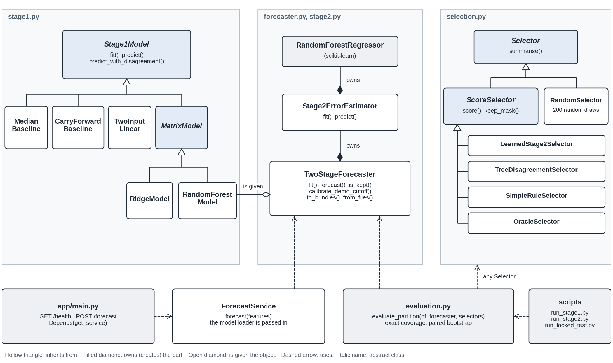

# Tanzania Antenatal Haemoglobin Forecasting

Capstone project for my Software Engineering degree at ALU (machine learning track).
Supervisor: Emmanuel Adjei

| | |
|---|---|
| GitHub repo | https://github.com/DubaKanu/tanzania-hb-forecasting |
| Technical report (PDF, 5 pages) | [docs/technical_report.pdf](docs/technical_report.pdf) |
| Walkthrough video of the final version |
| First demonstration video (Stage 1 only) | https://drive.google.com/file/d/1hme7EPQWwJKcGfEDZ_sLhvhIecOXRt67/view?usp=sharing |
| Live demo of the API | https://tanzania-hb-forecast-demo.onrender.com/docs (made-up values only; it runs on a free plan, so the first request after a quiet period can take about a minute) |

## What this does

The project has two stages, both trained on real antenatal records from Tanzania.

- **Stage 1** forecasts a woman's haemoglobin (Hb) at her next recorded antenatal visit, using ten values from her first visit (age, pregnancy history, blood pressure, pulse, and so on).
- **Stage 2** estimates how far each Stage 1 forecast is likely to be from the real value. The study then tests whether this estimate picks out the more reliable forecasts better than three simpler ways of choosing: how much the trees of the forest disagree, a rule based on missing inputs, and random choice.

This is a research demo, not a medical tool. It does not replace blood testing and it is not used to decide anyone's care. "Set aside" means a forecast is not counted in the evaluation. It does not mean a woman is refused a test.

## Where the project stands

| Part | Status |
|---|---|
| Data audit and fixed split (1,884 / 402 / 399 women) | Done |
| Stage 1: five models compared | Done |
| Stage 2: out-of-fold errors, error model, four ways of choosing forecasts compared | Done on the 402 development women |
| Locked test on the 399 reserved women | **Not run yet.** It runs once, after the supervisor has reviewed the protocol in `docs/frozen_protocol.md` and the protocol is frozen |
| Demo API with the Stage 2 output, tested against 8 acceptance checks and 148 input checks | Done |
| Hosting the demo on Render | Done. Live at https://tanzania-hb-forecast-demo.onrender.com/docs and checked on 18 October 2026, see `deployment_plan.md` |
| Data provenance, and the response to the supervisor's comments | Written: `docs/data_provenance.md` and `docs/response_table.md` |
| Final version (this submission) | Code organised into classes, the API hardened and more than six times faster, 316 automated tests, checks on Python 3.9 to 3.12, a technical report. See "Code design", "Testing" and "Performance and compatibility" below |

## Technical requirements

**Software.** The exact versions are pinned in `requirements.txt`.

| What | Version | Used for |
|---|---|---|
| Python | 3.9 to 3.12. Tested on 3.9.25, 3.10.20, 3.11.17 and 3.12.13. The hosted demo runs 3.11.9. Python 3.13 is not supported with the pinned libraries | everything |
| numpy, pandas, scipy | 2.0.2, 2.3.3, 1.13.1 | data and numerics |
| scikit-learn, joblib | 1.6.1, 1.4.2 | the models, and saving them |
| matplotlib | 3.9.4 | figures |
| FastAPI, uvicorn, pydantic | 0.115.6, 0.34.0, 2.10.4 | the demo API |
| httpx, pytest | 0.28.1, 8.3.4 | API tests, the speed test, the test suite |
| ruff, radon | 0.17.2, 6.0.1 (`requirements-dev.txt`) | style and complexity checks |
| jupyterlab, ipykernel, nbconvert | see `requirements-notebook.txt` | only to open the notebook |

No other SDK, database, GPU or compiler is needed. Every library installs from a ready-made build on Python 3.9 to 3.12. There is no executable or APK: the product is a Python service started with `python -m uvicorn app.main:app` (see "Installation and use"), and the hosted copy runs the same code.

**Operating system.** Developed and tested on Linux (Ubuntu 24.04). The hosted demo runs on Render, which is also Linux. The commands below are the same on macOS. On Windows use `venv\Scripts\activate` instead of `source venv/bin/activate` (not tested).

**Hardware.** Any 64-bit computer with 1 GB of free memory is enough. Measured on 2 vCPU (Intel Xeon, 2.80 GHz) with 8 GB of RAM: the API used about 180 MB and one CPU core, answered a forecast in about 11 ms, and rebuilding every result from the raw file took about 30 seconds. Render's free plan (512 MB) is enough for the API. Numbers and method: `docs/performance.md`.

## Installation and use

Use Python 3.9 to 3.12. The libraries in `requirements.txt` are pinned to exact versions. With them, Python 3.9, 3.10, 3.11 and 3.12 all gave the same numbers as below when checked on Linux. Other library versions can move some numbers by about 0.003 g/dL.

1. Get the code and install the libraries:

   ```
   git clone -b post-feedback-revision https://github.com/DubaKanu/tanzania-hb-forecasting.git
   cd tanzania-hb-forecasting
   python3 -m venv venv
   source venv/bin/activate
   pip install -r requirements.txt
   ```

   On Windows, activate with `venv\Scripts\activate`.
2. Check the install with `python -m pytest tests -q`. All 316 tests should pass in about a minute. This needs neither the raw file nor the internet.
3. Try the demo API with `python -m uvicorn app.main:app --reload`, then open `http://127.0.0.1:8000/docs`.
4. To rebuild the results from the raw file, download it from Zenodo and save it as `data/raw/maternal_dataset_csv.csv`. `data/raw/README.md` has the link and the checksum to check. Then run:
   - `python src/audit.py` checks the file and reproduces the counts
   - `python src/run_stage1.py` compares the five models, saves the chosen one and the fixed fold assignments
   - `python src/run_stage2.py` builds the out-of-fold errors, trains Stage 2, compares the ways of choosing forecasts on the development women and saves the Stage 2 model, tables and figures in `reports/`
   - `python scripts/check_reproducibility.py` runs those three in a temporary copy and compares the 19 files they make with the ones in the repository. Nothing in the repository changes
5. To measure the speed of the API, run `python scripts/benchmark_api.py --start-local --label my-machine`.
6. To run the code checks, `pip install -r requirements-dev.txt` and then `ruff check .`.
7. To open the notebook, `pip install -r requirements-notebook.txt` and open `notebooks/model_notebook.ipynb`.

The locked test is not part of the normal steps. After the supervisor has reviewed `docs/frozen_protocol.md`, `python src/freeze_protocol.py` records the protocol, code, data and models, and `python src/run_locked_test.py` runs the 399 reserved women once. It refuses to run if anything changed after the freeze, if the libraries are not the ones used at the freeze, and it refuses to run a second time. `run_stage1.py` and `run_stage2.py` must not be rerun after the freeze.

## Repository structure

```
.
├── README.md
├── requirements.txt            pinned libraries for the code, the API and the tests
├── requirements-dev.txt        the same, plus ruff and radon for the code checks
├── requirements-notebook.txt   extra libraries for the notebook
├── ruff.toml                   style, bug and complexity rules (maximum complexity 10)
├── render.yaml                 settings for the hosted demo on Render
├── deployment_plan.md          how the demo is hosted, and what is out of scope
├── .github/workflows/          tests on Python 3.9 to 3.12 and the style check, on every upload
├── src/                        the modelling code. Modules define classes and functions only; five thin scripts run them
│   ├── data_adapter.py         the only reader of the raw file (12 of its 683 columns)
│   ├── pipeline.py             eligibility rules, identical-record groups, fixed split, cross-validation fold rule
│   ├── metrics.py              error measures, exact-coverage ranking, paired bootstrap
│   ├── stage1.py               Stage1Model and its five implementations, cross-validation, tree predictions
│   ├── stage2.py               Stage2ErrorEstimator and the out-of-fold table
│   ├── forecaster.py           TwoStageForecaster: the one path used by evaluation, the locked test and the API
│   ├── selection.py            Selector and its implementations (learned, tree disagreement, simple rule, oracle, random)
│   ├── evaluation.py           coverage tables, bootstrap comparisons, who-is-set-aside audit
│   ├── reporting.py            tables, figures and the results files
│   ├── provenance.py           checksums and library versions
│   ├── audit.py                step 1: reproduce the counts from the raw file
│   ├── run_stage1.py           step 2: compare the five Stage 1 models
│   ├── run_stage2.py           step 3: Stage 2 and the comparison on the development women
│   └── freeze_protocol.py, run_locked_test.py    the locked test (not run yet)
├── app/                        the API: main.py (routes), schemas.py (inputs and limits), service.py, errors.py
├── tests/                      316 tests in 16 files, plus conftest.py and helpers.py
├── scripts/                    benchmark_api.py, check_reproducibility.py, make_class_diagram.py
├── models/                     the saved Stage 1 and Stage 2 models
├── reports/                    audit, Stage 1 and Stage 2 results, tables, figures, speed measurements
├── docs/                       technical report, data dictionary, performance, protocol for the locked test, data provenance,
│                               response to the supervisor's comments, acceptance checks, class diagram
├── data/                       prepared files, split manifest, fold assignments. data/raw/ holds only a note on how to fetch the raw file
└── notebooks/                  model_notebook.ipynb with the charts and results
```

Cross-validation folds come from a fixed rule in `src/pipeline.py`, not from scikit-learn's `GroupKFold`, whose tie-breaking changed between versions and shifted the results slightly. Column names, ranges and missing values of every prepared file are in `docs/data_dictionary.md`.

Branches: the final version is on `post-feedback-revision`. The first demonstration is the release tag `initial-demo-submitted`.

## Code design

The classes follow the class design in the proposal (Figure 4) and my supervisor's comments on it. The figure is drawn from the code by `scripts/make_class_diagram.py`.



| Class | Job | Design idea |
|---|---|---|
| `Stage1Model` (abstract) and five subclasses | forecast Hb at the next recorded visit | Inheritance and polymorphism. Cross-validation, saving and evaluation treat the five models the same way, and a sixth model is one new subclass |
| `Stage2ErrorEstimator` | learn how large each forecast's error is likely to be | Composition. It owns its random forest |
| `TwoStageForecaster` | forecast and estimated error for any table of women | The single path used by the evaluation, the locked test and the API, so the API returns what the offline code returns, by construction |
| `Selector` (abstract), `ScoreSelector` and five subclasses | the ways of choosing which forecasts to keep | Open for extension. A new way of choosing is one new subclass and `evaluate_partition` does not change |
| `ForecastService` | the API's job: validated inputs in, forecast out | Dependency inversion. It is given a loader function, so tests use fakes and FastAPI injects it with `Depends` |

Other choices: every script is a short list of steps, each step a function, and nothing runs when a module is imported. The longest function in `src/` is 32 lines. The saved models are plain scikit-learn objects in dictionaries, so the files in `models/` load without any class from this code. `ruff check .` checks style, likely bugs and complexity (limit 10), and the 243 classes, functions and methods in `src/`, `app/` and `scripts/` average a cyclomatic complexity of 2.2 (grade A on radon's scale), with 15 at grade B and none worse (the highest is 10).

## Testing

`python -m pytest tests -q` runs 316 tests in about a minute. They need no raw file and no internet.

| Layer | Tests | What they check |
|---|---|---|
| Modelling code (`test_pipeline`, `test_metrics`, `test_stage1_models`, `test_stage2`, `test_selection`, `test_evaluation`, `test_forecaster`, `test_data_adapter`, `test_provenance_audit`) | 101 | the fold rule, exact coverage, the bootstrap, the five models, out-of-fold forecasts that never saw the woman, the selectors, saving and loading, the audit. Synthetic cohorts only, never reported as results |
| Reproducibility check (`test_reproducibility_check`) | 11 | how a rebuilt file is judged the same as the committed one |
| Locked-test guards (`test_locked_test_guards`) | 11 | the locked test refuses to run without a freeze, after a change or twice, and development scripts never read `test.csv` |
| API and service (`test_api`, `test_api_inputs`, `test_api_errors`, `test_service`) | 190 | the 8 acceptance checks, every input limit and just outside it, NaN, infinity, huge numbers, wrong types, missing optional values, malformed requests, a missing model file, models loaded once |
| Speed (`test_performance`) | 3 | the models are read once, a request takes under 0.1 s (median), 402 women take under 2 s |

Outside pytest:

- `python scripts/check_reproducibility.py` rebuilds the 19 derived files from the raw file and compares them with the repository. After the code was reorganised into classes it found no changed number. On Python 3.9.25, the version that built the committed files, all 19 are identical byte for byte. On Python 3.10, 3.11 and 3.12, 14 are identical and 5 differ only in the Python version saved inside them.
- Input testing found a real defect: NaN, Infinity or a huge number in eight of the inputs gave HTTP 500 and not a 422 (the first submitted version did the same, checked by running it). Every input now has limits, NaN and Infinity are refused, and the error message never repeats the value sent.
- `scripts/benchmark_api.py` and a profile found that scikit-learn's repeated input checks used most of the time of a request. The fix gives the same numbers to the last digit and makes a request more than six times faster (median 73.5 ms to 11.1 ms).
- A GitHub Actions workflow runs the tests on Python 3.9, 3.10, 3.11 and 3.12 and `ruff check .` on every upload.

The acceptance checks are in `docs/acceptance_checks.md`, and the measurements in `docs/performance.md`.

## Performance and compatibility

Measured on 2 vCPU with 8 GB of RAM, Python 3.11.17, one server process (details in `docs/performance.md`):

| | Result |
|---|---|
| One forecast request, median and 95th percentile | 11.1 ms and 17.2 ms (73.5 ms and 107.4 ms before the fix) |
| Requests per second with the server on one core | about 80 |
| Memory of the server after loading both models | about 180 MB |
| 402 development women forecast in one call | 0.022 s |
| Start until `/health` answers | 1.5 s |

Python 3.9, 3.10, 3.11 and 3.12 all pass the tests and rebuild the same results. Python 3.13 cannot install the pinned scipy (no ready-made build), so it is not supported. Linux only has been measured. The speed of the hosted copy on Render's free plan was not measured; the command is in `docs/performance.md`.

## Data

### Source and licence

The data are from *Dataset for Maternal Health Risks Stratification (MHRS) in Tanzania*, Version 1, published on Zenodo on 30 April 2025 ([DOI 10.5281/zenodo.15309733](https://zenodo.org/records/15309733)). Licence: [Creative Commons Attribution 4.0 International (CC BY 4.0)](https://creativecommons.org/licenses/by/4.0/). Creators as listed on the record: Rukia Mwifunyi, Nyaura Kibinda, Noe Elisa, Florence Upendo Rashidi, Kilavo Hassan, Mustafa Mohsini, Theresia Masoi, Lilian Mnabwiru, Yahaya Hussein and Saturini Manangwa. The University of Dodoma hosts the record, and the Wellcome Trust and the Lacuna Fund are listed as funders. The record describes 8,817 women attending maternity primary health facilities in five districts of Tanzania (Chamwino, Mkuranga, Meatu, Mbulu and Kilolo), with data collection from 20 May 2024 to 30 March 2025.

This project uses Version 1 only (a newer version of the record exists): file `maternal_dataset_csv.csv`, MD5 `0253d2d385dd80d6c9bb82df6b85fcc8`. The raw file is not stored in this repository. To rerun the audit, Stage 1 or the notebook, download it from the Zenodo record, check the checksum and save it as `data/raw/maternal_dataset_csv.csv`. The link, both checksums and the steps are in `data/raw/README.md` and `docs/data_provenance.md`. The prepared files, the split manifest and the saved models are in the repository, so the tests and the demo API run without the raw file. Everything derived from the raw file was made by the code in this repository.

### Ethics and data handling

This is a secondary analysis of an existing open dataset. No new data were collected and no participants were contacted. I could not find an ethics approval, a consent procedure or a de-identification method on the Zenodo record page or in the record's `metadata.pdf` (a data dictionary of 36 features), and this project does not claim any for the data. The file has no name, phone, address, facility or district columns, and its `SN` column is only a row number, so it holds no patient ID. It does contain sensitive clinical columns (for example HIV test results and intimate partner violence), calendar dates (for example the last menstrual period) and a few free-text clinical note fields. This project uses none of them. The file also includes girls aged 16 or under: 315 of its 8,817 rows, and 63 of the 2,685 rows used. Only 12 of the file's 683 columns are loaded (`RAW_COLUMNS` in `src/data_adapter.py`): the ten first-visit inputs, the next-visit haemoglobin, the gestational week of that visit (used only to check that it comes after the first) and the file's row number. The dataset's own risk label is not read. The demonstration API is for made-up values only and stores nothing. What the record and `metadata.pdf` do not say, and the ethics review status, are in section 5 of `docs/data_provenance.md`.

### Cohort and split

After cleaning and keeping only women with two recorded visits, 2,685 women are used. They are split into 1,884 for training, 402 for development and 399 reserved for a final test that has not been used yet. Women with an identical set of first-visit values are kept in the same group, though without a patient ID this cannot prove the groups are independent.

`src/audit.py` reproduces the 2,685 count, every exclusion step, the missing values and the split sizes from the raw file (fetched as described above), and checks the file's checksum.

## How Stage 2 works

A lower Stage 2 score means a more reliable forecast.

1. **Out-of-fold forecasts.** The training women are split into 3 folds. Each woman is forecast by a model that never saw her, and her error is the gap between the observed Hb and that forecast.
2. **Train the error model.** Stage 2 is a second random forest trained on those honest errors only, never on errors from women the model had already seen. Its inputs are the ten first-visit values, the Stage 1 forecast and the disagreement among the trees of the Stage 1 forest.
3. **Use it on new women.** The frozen Stage 1 forest gives the forecast and the tree disagreement, and Stage 2 turns them into an estimated error.

To compare ways of choosing, each one keeps the forecasts with the lowest scores. The share kept is the coverage (100%, 90%, 80% and 70%, with 80% as the main one) and the result is the mean absolute error of the kept forecasts.

## Results on the 402 development women

These are development results. The locked test has not been run, so none of this is a final result.

### Stage 1: forecasting

Average error in g/dL (lower is better). The model is chosen by the training column, not by the development one.

| Model | Training cross-validation | Development |
|---|---|---|
| Random Forest | 0.760 | 0.794 |
| Ridge regression | 0.800 | 0.807 |
| First haemoglobin and gestational week only | 0.810 | 0.811 |
| Carry previous reading forward | 0.879 | 0.926 |
| Just guess the average | 1.133 | 1.080 |

The forest is clearly better than the two-input model in training cross-validation (difference -0.050 g/dL, 95% interval -0.064 to -0.036). On the 402 development women the gap is -0.017 g/dL (95% interval -0.045 to +0.011), which cannot be told apart from zero. So the extra eight inputs help a little, and this sample is too small to be sure.

### Stage 2: choosing reliable forecasts

Average error of the forecasts that are kept, in g/dL. Keeping every forecast (100%) gives 0.794.

| How forecasts are chosen | 90% kept | 80% kept | 70% kept |
|---|---|---|---|
| Learned Stage 2 score | 0.753 | 0.698 | 0.693 |
| Tree disagreement | 0.764 | 0.713 | 0.671 |
| Simple rule (missing inputs) | 0.759 | 0.796 | 0.771 |
| Random choice (average of 200 draws) | 0.794 | 0.794 | 0.793 |


What this shows:

- The learned score and tree disagreement both do better than random choice. At 80% coverage, 95% of 200 random draws fall between 0.759 and 0.835, and both methods are below that range.
- The question set in advance is learned minus tree disagreement at 80% coverage. The result is -0.015 g/dL (95% interval -0.058 to +0.025). The interval crosses zero, so this shows neither that the learned score is better nor that the two are equivalent. With 402 women the interval is about 0.04 g/dL wide on each side, so only a bigger difference than that could be shown.
- The simple missing-inputs rule is no better than keeping every forecast at 80% coverage (0.796 against 0.794). It does not replace the machine learning.
- Tree disagreement costs nothing extra, because it comes from the forest that is already there. Any gain from the learned score has to be measured against it.
- The score does track the real error. Women in the lowest fifth of Stage 2 scores had an average real error of 0.61 g/dL and women in the highest fifth had 1.19 g/dL.
- Repeating everything on women with all ten inputs gives -0.043 g/dL (95% interval -0.088 to +0.005), which also crosses zero.

### Who is set aside at 80% coverage

| First haemoglobin | Women | Kept by the learned score | Kept by tree disagreement |
|---|---|---|---|
| Below 10 g/dL | 68 | 31 (46%) | 37 (54%) |
| 10 to below 11 g/dL | 108 | 107 (99%) | 108 (100%) |
| 11 g/dL and above | 226 | 184 (81%) | 177 (78%) |

Both methods set aside far more of the women whose first Hb is below 10 than of other women. The learned score sets aside 54% of them (37 of 68) and tree disagreement sets aside 46% (31 of 68). Among women at 10 to below 11 the figures are 1% and 0%, and at 11 and above they are 19% and 22%. This is the fairness question of the study, and it is reported before the locked test. There is no clear sign that women with incomplete inputs are set aside more often: the learned score keeps 78.2% of them and 80.6% of women with complete inputs, and tree disagreement keeps 80.5% and 80.0%. The simple rule keeps only 8% of women with incomplete inputs, because that is what it is built to do.

The full tables, figures and every paired comparison are in `reports/stage2_dev_results.md`.

## The demo API

`POST /forecast` takes a woman's first-visit values. Hb, gestational week, age, number of pregnancies, height and weight are required. Pulse, respiratory rate and the two blood pressures are optional and are filled in if missing (leave them out or send `null`). Every input has limits: Hb 3 to 20 g/dL, gestational week 1 to 42, age 10 to 60, number of pregnancies 0 to 25, height 100 to 200 cm, weight 30 to 150 kg, pulse 20 to 250, breaths per minute 4 to 120, systolic pressure 40 to 300 and diastolic pressure 10 to 200 mmHg. Anything outside the limits, and NaN or Infinity, is refused with a 422 error that does not repeat the value that was sent. The column-by-column description of the inputs and outputs is in `docs/data_dictionary.md`.

Example request (made-up values):

```json
{
  "hb_visit1_g_dl": 10.8,
  "gestation_visit1_weeks": 20,
  "maternal_age_years": 28,
  "pregnancy_count": 2,
  "height_cm": 160,
  "weight_visit1_kg": 62,
  "pulse_visit1_bpm": 80,
  "respiratory_rate_visit1": 18,
  "systolic_bp_visit1": 118,
  "diastolic_bp_visit1": 76
}
```

It returns the Stage 1 forecast, the Stage 2 estimated error, whether the forecast would be kept or set aside, the cutoff used, and a research-only disclaimer. The response to that request, from the saved models (the live copy gave the same numbers):

```json
{
  "predicted_hb_visit2_g_dl": 10.56,
  "estimated_abs_error_g_dl": 0.492,
  "reliability_flag": "kept",
  "cutoff_g_dl": 0.915,
  "reliability_note": "The estimated error of 0.49 g/dL is at or below the research cutoff, so this forecast would be kept in the research evaluation. ...",
  "disclaimer": "Research demonstration output only. Not a diagnosis. Does not replace clinical blood testing."
}
```

One woman cannot be ranked against others, so the API needs a cutoff. It uses the 80th percentile of the Stage 2 scores of the development women (0.915 g/dL). This cutoff is fitted on development data, so it is a different method from the exact-coverage ranking used in the evaluation, and the response says so. The service stores nothing it receives and does not log the inputs.

### The hosted demo

The demo runs on Render's free plan at https://tanzania-hb-forecast-demo.onrender.com. Open `/docs`, choose `POST /forecast`, click Try it out, paste the request above and click Execute. Use made-up values only.

- `GET /health` shows `"model_loaded": false` until the first valid forecast has been made, and `true` after that. The two models are read from disk on the first valid forecast, not when the service starts. So `false` at the start is normal, and `"status": "ok"` is the part that says the service is up. It goes back to `false` after the service has slept and woken up.
- The free plan stops the service after 15 minutes without requests. The first request after that can take about a minute while it wakes up.
- A request that fails the input check, such as an Hb of 25, is refused with a 422 error before any model code runs. It does not load the models.
- Checked on the live copy on 18 October 2026: the request above returned 200 with a forecast of 10.56, an estimated error of 0.492 and "kept"; an Hb of 25 returned 422; and `/health` showed `"model_loaded": true` afterwards. The details are in `docs/acceptance_checks.md`.

## Designs

Charts made from the real data are saved in `notebooks/`: missingness per feature, first-visit against second-visit haemoglobin, the gap in weeks between visits, the Stage 1 model comparison, and error against coverage for Stage 2. The Stage 2 figures are also in `reports/`. Screenshots of the Swagger interface show a sample request and its response. `docs/swagger_interface_stage2.png` is the current version, with the Stage 2 estimated error and the kept flag, and `Swagger interface; Figure.png` is the earlier Stage 1 version. They are the closest thing to an interface screenshot for this project.

## Deployment plan

The demo API (`app/main.py`) is hosted on Render's free plan at https://tanzania-hb-forecast-demo.onrender.com. It was created on 18 October 2026 as a Blueprint from `render.yaml`, using the `post-feedback-revision` branch, with Python fixed to 3.11.9 and the saved models committed in the repo. The settings, what to expect on the free plan, the checks run on the live copy and what is out of scope are in `deployment_plan.md`. There is no app, no SMS and no hospital system, and that is intentional.

## Limits

- This is internal validation on one public dataset from five Tanzanian districts, not nationally representative. It is not temporal or external validation, and it is not clinical evidence.
- There is no verified patient ID, so keeping identical first-visit rows together is only a proxy for the same woman.
- The target is Hb at the next recorded visit. The gap between visits runs from 1 to 28 weeks (median 4), so it is not a fixed-interval forecast.
- Only women with a repeat test are included, which selects women who were tested twice.
- The forests that make the Stage 2 training table are fitted on two thirds of the training women, so Stage 2 later receives forecasts from a slightly stronger forest than the one that produced its examples.
- The Stage 2 score ranks forecasts. It is not a confidence interval.
- Speed and compatibility were measured on Linux only. Python 3.13 is not supported with the pinned libraries, and macOS and Windows were not tested by me.
- All results above are development results. The locked test on the 399 reserved women has not been run.
