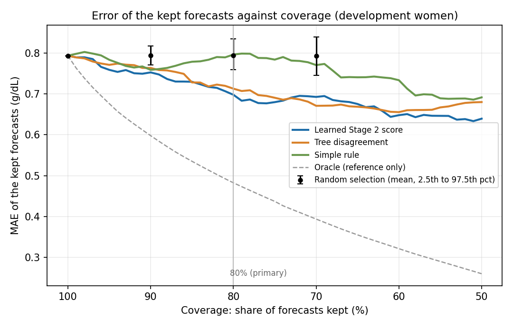

# Tanzania Antenatal Haemoglobin Forecasting

Capstone project for my Software Engineering degree at ALU.
Supervisor: Emmanuel Adjei

GitHub repo: https://github.com/DubaKanu/tanzania-hb-forecasting

Video demo (the initial Stage 1 demonstration): https://drive.google.com/file/d/1hme7EPQWwJKcGfEDZ_sLhvhIecOXRt67/view?usp=sharing

Live demo of the API (made-up values only; it runs on a free plan, so the first request after a quiet period can take about a minute): https://tanzania-hb-forecast-demo.onrender.com/docs

## What this does

The project has two stages, both trained on real antenatal records from Tanzania.

- **Stage 1** forecasts a woman's haemoglobin (Hb) at her next recorded antenatal visit, using ten values from her first visit (age, pregnancy history, blood pressure, pulse, and so on).
- **Stage 2** estimates how far each Stage 1 forecast is likely to be from the real value. The study then tests whether this estimate picks out the more reliable forecasts better than three simpler ways of choosing: how much the trees of the forest disagree, a rule based on missing inputs, and random choice.

This is a research demo, not a medical tool. It does not replace blood testing and it is not used to decide anyone's care. "Set aside" means a forecast is not counted in the evaluation. It does not mean a woman is refused a test.

## Where the project stands

| Part | Status |
|---|---|
| Data audit and fixed split (1,884 / 402 / 399 women) | Done |
| Stage 1: five models compared | Done |
| Stage 2: out-of-fold errors, error model, four ways of choosing forecasts compared | Done on the 402 development women |
| Locked test on the 399 reserved women | **Not run yet.** It runs once, after the protocol in `docs/frozen_protocol.md` is frozen |
| Demo API with the Stage 2 output, tested against 8 acceptance checks | Done, runs locally |
| Hosting the demo on Render | Done. Live at https://tanzania-hb-forecast-demo.onrender.com/docs and checked on 18 October 2026, see `deployment_plan.md` |

## Data

### Source and licence

The data are from *Dataset for Maternal Health Risks Stratification (MHRS) in Tanzania*, Version 1, published on Zenodo on 30 April 2025 ([DOI 10.5281/zenodo.15309733](https://zenodo.org/records/15309733)). Licence: [Creative Commons Attribution 4.0 International (CC BY 4.0)](https://creativecommons.org/licenses/by/4.0/). Creators as listed on the record: Rukia Mwifunyi, Nyaura Kibinda, Noe Elisa, Florence Upendo Rashidi, Kilavo Hassan, Mustafa Mohsini, Theresia Masoi, Lilian Mnabwiru, Yahaya Hussein and Saturini Manangwa. The University of Dodoma hosts the record, and the Wellcome Trust and the Lacuna Fund are listed as funders. The record describes 8,817 women attending maternity primary health facilities in five districts of Tanzania (Chamwino, Mkuranga, Meatu, Mbulu and Kilolo), with data collection from 20 May 2024 to 30 March 2025.

This project uses Version 1 only (a newer version of the record exists): file `maternal_dataset_csv.csv`, MD5 `0253d2d385dd80d6c9bb82df6b85fcc8`. The copy in `data/raw/` is that file, unmodified, so that everything can be rerun. Everything derived from it was made by the code in this repository.

### Ethics and data handling

This is a secondary analysis of an existing open dataset. No new data were collected and no participants were contacted. I could not find an ethics approval, a consent procedure or a de-identification method on the Zenodo record page, and this project does not claim any for the data. The file has no name, phone, address, facility or district columns, and its `SN` column is only a row number, so it holds no patient ID. It does contain sensitive clinical columns (for example HIV test results and intimate partner violence) that this project does not use. Only the ten first-visit inputs and the next-visit haemoglobin are used. The demonstration API is for made-up values only and stores nothing.

### Cohort and split

After cleaning and keeping only women with two recorded visits, 2,685 women are used. They are split into 1,884 for training, 402 for development and 399 reserved for a final test that has not been used yet. Women with an identical set of first-visit values are kept in the same group, though without a patient ID this cannot prove the groups are independent.

`src/audit.py` reproduces the 2,685 count, every exclusion step, the missing values and the split sizes from the raw file, and checks the file's checksum.

## How Stage 2 works

A lower Stage 2 score means a more reliable forecast.

1. **Out-of-fold forecasts.** The training women are split into 3 folds. Each woman is forecast by a model that never saw her, and her error is the gap between the observed Hb and that forecast.
2. **Train the error model.** Stage 2 is a second random forest trained on those honest errors only, never on errors from women the model had already seen. Its inputs are the ten first-visit values, the Stage 1 forecast and the disagreement among the trees of the Stage 1 forest.
3. **Use it on new women.** The frozen Stage 1 forest gives the forecast and the tree disagreement, and Stage 2 turns them into an estimated error.

To compare ways of choosing, each one keeps the forecasts with the lowest scores. The share kept is the coverage (100%, 90%, 80% and 70%, with 80% as the main one) and the result is the mean absolute error of the kept forecasts.

## Results on the 402 development women

These are development results. The locked test has not been run, so none of this is a final result.

### Stage 1: forecasting

Average error in g/dL (lower is better). The model is chosen by the training column, not by the development one.

| Model | Training cross-validation | Development |
|---|---|---|
| Random Forest | 0.760 | 0.794 |
| Ridge regression | 0.800 | 0.807 |
| First haemoglobin and gestational week only | 0.810 | 0.811 |
| Carry previous reading forward | 0.879 | 0.926 |
| Just guess the average | 1.133 | 1.080 |

The forest is clearly better than the two-input model in training cross-validation (difference -0.050 g/dL, 95% interval -0.064 to -0.036). On the 402 development women the gap is -0.017 g/dL (95% interval -0.045 to +0.011), which cannot be told apart from zero. So the extra eight inputs help a little, and this sample is too small to be sure.

### Stage 2: choosing reliable forecasts

Average error of the forecasts that are kept, in g/dL. Keeping every forecast (100%) gives 0.794.

| How forecasts are chosen | 90% kept | 80% kept | 70% kept |
|---|---|---|---|
| Learned Stage 2 score | 0.753 | 0.698 | 0.693 |
| Tree disagreement | 0.764 | 0.713 | 0.671 |
| Simple rule (missing inputs) | 0.759 | 0.796 | 0.771 |
| Random choice (average of 200 draws) | 0.794 | 0.794 | 0.793 |



What this shows:

- The learned score and tree disagreement both do better than random choice. At 80% coverage, 95% of 200 random draws fall between 0.759 and 0.835, and both methods are below that range.
- The question set in advance is learned minus tree disagreement at 80% coverage. The result is -0.015 g/dL (95% interval -0.058 to +0.025). The interval crosses zero, so this shows neither that the learned score is better nor that the two are equivalent. With 402 women the interval is about 0.04 g/dL wide on each side, so only a bigger difference than that could be shown.
- The simple missing-inputs rule is no better than keeping every forecast at 80% coverage (0.796 against 0.794). It does not replace the machine learning.
- Tree disagreement costs nothing extra, because it comes from the forest that is already there. Any gain from the learned score has to be measured against it.
- The score does track the real error. Women in the lowest fifth of Stage 2 scores had an average real error of 0.61 g/dL and women in the highest fifth had 1.19 g/dL.
- Repeating everything on women with all ten inputs gives -0.043 g/dL (95% interval -0.088 to +0.005), which also crosses zero.

### Who is set aside at 80% coverage

| First haemoglobin | Women | Kept by the learned score | Kept by tree disagreement |
|---|---|---|---|
| Below 10 g/dL | 68 | 31 (46%) | 37 (54%) |
| 10 to below 11 g/dL | 108 | 107 (99%) | 108 (100%) |
| 11 g/dL and above | 226 | 184 (81%) | 177 (78%) |

Both methods set aside more than half of the women whose first Hb is below 10. This is the fairness question of the study, and it is reported before the locked test. Women with incomplete inputs are not set aside more often (78% of them kept by the learned score, against 81% of women with complete inputs). The simple rule keeps only 8% of women with incomplete inputs, because that is what it is built to do.

The full tables, figures and every paired comparison are in `reports/stage2_dev_results.md`.

## How to run it

Use Python 3.9 to 3.12. The libraries in `requirements.txt` are pinned to exact versions. With them, Python 3.9, 3.10, 3.11 and 3.12 all gave the same numbers as above when checked on Linux. Other library versions can move some numbers by about 0.003 g/dL.

1. Make a virtual environment and install the libraries:
   `python3 -m venv venv`, then `source venv/bin/activate` (on Windows `venv\Scripts\activate`), then `pip install -r requirements.txt`
2. `python src/audit.py` checks the data and reproduces the counts
3. `python src/run_stage1.py` compares the five models, saves the chosen one and the fixed fold assignments
4. `python src/run_stage2.py` builds the out-of-fold errors, trains Stage 2, compares the ways of choosing forecasts on the development women and saves the Stage 2 model, tables and figures in `reports/`
5. `pytest tests/` runs the tests, including the acceptance checks for the API (see `docs/acceptance_checks.md`)
6. To try the demo API: `python3 -m uvicorn app.main:app --reload`, then open `http://127.0.0.1:8000/docs`
7. To open the notebook: `pip install -r requirements-notebook.txt`, then open `notebooks/model_notebook.ipynb`

The locked test is not part of the normal steps. After the supervisor has seen `docs/frozen_protocol.md`, `python src/freeze_protocol.py` records the protocol, code, data and models, and `python src/run_locked_test.py` runs the 399 reserved women once. It refuses to run if anything changed after the freeze, if the libraries are not the ones used at the freeze, and it refuses to run a second time. Steps 3 and 4 must not be rerun after the freeze.

## The demo API

`POST /forecast` takes a woman's first-visit values. Hb, gestational week, age, number of pregnancies, height and weight are required. Pulse, respiratory rate and the two blood pressures are optional and are filled in if missing. Hb must be 3 to 20 g/dL, gestational week 1 to 42, age 10 to 60, height 100 to 200 cm and weight 30 to 150 kg. Anything outside these ranges is refused with a 422 error.

Example request (made-up values):

```json
{
  "hb_visit1_g_dl": 10.8,
  "gestation_visit1_weeks": 20,
  "maternal_age_years": 28,
  "pregnancy_count": 2,
  "height_cm": 160,
  "weight_visit1_kg": 62,
  "pulse_visit1_bpm": 80,
  "respiratory_rate_visit1": 18,
  "systolic_bp_visit1": 118,
  "diastolic_bp_visit1": 76
}
```

It returns the Stage 1 forecast, the Stage 2 estimated error, whether the forecast would be kept or set aside, the cutoff used, and a research-only disclaimer. The response to that request, from the saved models (the live copy gave the same numbers):

```json
{
  "predicted_hb_visit2_g_dl": 10.56,
  "estimated_abs_error_g_dl": 0.492,
  "reliability_flag": "kept",
  "cutoff_g_dl": 0.915,
  "reliability_note": "The estimated error of 0.49 g/dL is at or below the research cutoff, so this forecast would be kept in the research evaluation. ...",
  "disclaimer": "Research demonstration output only. Not a diagnosis. Does not replace clinical blood testing."
}
```

One woman cannot be ranked against others, so the API needs a cutoff. It uses the 80th percentile of the Stage 2 scores of the development women (0.915 g/dL). This cutoff is fitted on development data, so it is a different method from the exact-coverage ranking used in the evaluation, and the response says so. The service stores nothing it receives and does not log the inputs.

### The hosted demo

The demo runs on Render's free plan at https://tanzania-hb-forecast-demo.onrender.com. Open `/docs`, choose `POST /forecast`, click Try it out, paste the request above and click Execute. Use made-up values only.

- `GET /health` shows `"model_loaded": false` until the first valid forecast has been made, and `true` after that. The two models are read from disk on the first valid forecast, not when the service starts. So `false` at the start is normal, and `"status": "ok"` is the part that says the service is up. It goes back to `false` after the service has slept and woken up.
- The free plan stops the service after 15 minutes without requests. The first request after that can take about a minute while it wakes up.
- A request that fails the input check, such as an Hb of 25, is refused with a 422 error before any model code runs. It does not load the models.
- Checked on the live copy on 18 October 2026: the request above returned 200 with a forecast of 10.56, an estimated error of 0.492 and "kept"; an Hb of 25 returned 422; and `/health` showed `"model_loaded": true` afterwards. The details are in `docs/acceptance_checks.md`.

## Designs

Charts made from the real data are saved in `notebooks/`: missingness per feature, first-visit against second-visit haemoglobin, the gap in weeks between visits, the Stage 1 model comparison, and error against coverage for Stage 2. The Stage 2 figures are also in `reports/`. Screenshots of the Swagger interface show a sample request and its response. `docs/swagger_interface_stage2.png` is the current version, with the Stage 2 estimated error and the kept flag, and `Swagger interface; Figure.png` is the earlier Stage 1 version. They are the closest thing to an interface screenshot for this project.

## Deployment plan

The demo API (`app/main.py`) is hosted on Render's free plan at https://tanzania-hb-forecast-demo.onrender.com. It was created on 18 October 2026 as a Blueprint from `render.yaml`, using the `post-feedback-revision` branch, with Python fixed to 3.11.9 and the saved models committed in the repo. The settings, what to expect on the free plan, the checks run on the live copy and what is out of scope are in `deployment_plan.md`. There is no app, no SMS and no hospital system, and that is intentional.

## Limits

- This is internal validation on one public dataset from five Tanzanian districts, not nationally representative. It is not temporal or external validation, and it is not clinical evidence.
- There is no verified patient ID, so keeping identical first-visit rows together is only a proxy for the same woman.
- The target is Hb at the next recorded visit. The gap between visits runs from 1 to 28 weeks (median 4), so it is not a fixed-interval forecast.
- Only women with a repeat test are included, which selects women who were tested twice.
- The forests that make the Stage 2 training table are fitted on two thirds of the training women, so Stage 2 later receives forecasts from a slightly stronger forest than the one that produced its examples.
- The Stage 2 score ranks forecasts. It is not a confidence interval.

## What's in here

- `src/`: data cleaning, Stage 1 and Stage 2 code, and the scripts `audit.py`, `run_stage1.py`, `run_stage2.py`, `freeze_protocol.py` and `run_locked_test.py`
- `notebooks/`: the main notebook with charts and results
- `app/`: the API
- `tests/`: unit tests and the API acceptance checks
- `models/`: the saved Stage 1 and Stage 2 models
- `reports/`: the audit report, Stage 1 and Stage 2 results, tables and figures
- `docs/`: the protocol for the locked test, the acceptance checks and the current interface screenshot
- `data/`: the raw file, the prepared files, the split manifest and the fold assignments
- `deployment_plan.md`, `render.yaml`: how the demo is hosted on Render, and the Render settings
- Cross-validation folds come from a fixed rule in `src/pipeline.py`, not from scikit-learn's `GroupKFold`, whose tie-breaking changed between versions and shifted the results slightly.
